# 🤖 AI 超级智能体项目（yu-ai-agent）

基于 Spring Boot 3、Java 21 与 Spring AI 构建的开源企业级 AI 应用与自主规划智能体实战项目，由 [程序员鱼皮](http://dogyupi.com/) 与编程导航团队原创出品，包含「AI 恋爱大师」情感问答应用以及基于 ReAct 模式的自主规划超级智能体 `YuManus`（OpenManus Java 架构实现）。

[](https://www.oracle.com/java/)
[](https://spring.io/projects/spring-boot)
[](https://spring.io/projects/spring-ai)
[](https://github.com/langchain4j/langchain4j)

[项目介绍](#-项目介绍) · [核心功能](#-核心功能) · [技术架构](#-技术架构) · [仓库结构](#-仓库结构) · [学习大纲](#-学习大纲) · [准备工作与生态资源](#-准备工作与生态资源) · [常见问题](#-常见问题) · [加入系统学习](#-加入系统学习)

> 本仓库为教学实战项目，在 [编程导航 AI 超级智能体课程主页](https://www.codefather.cn/course/1915010091721236482) 提供完整视频教程、配套文字笔记、简历写法参考、面试题解与 1 对 1 答疑服务，帮助你真正把企业级 AI 开发技术学透并转化为求职竞争力。欢迎直接通过 [编程导航会员通道](https://www.codefather.cn/vip) 加入系统学习，也可以先前往 B 站观看 [项目整体介绍视频](https://www.bilibili.com/video/BV1UoLezKEbm) 与 [第一期免费公开课](https://www.bilibili.com/video/BV1Eq5DzcE9o)。

## ✨ 项目介绍

随着大模型技术深入各行各业，能够独立设计并落地 AI 应用与智能体的 Java 工程师正成为企业争抢的核心人才。`yu-ai-agent` 是一套以企业级 AI 开发实战为核心的开源项目，通过从零开发「AI 恋爱大师应用」和具备自主推理规划能力的「超级智能体 YuManus」，带你系统掌握新时代程序员必知必会的 AI 核心概念、主流框架原理、RAG 检索调优、工具调用以及 MCP 服务开发能力。

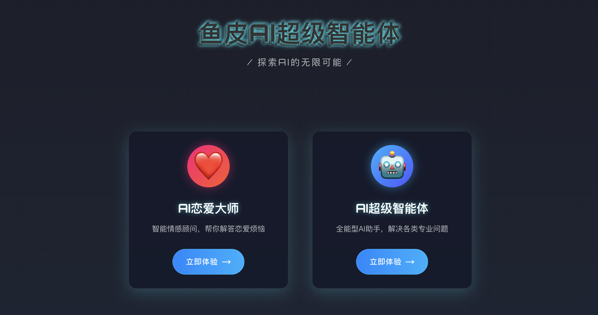

在项目实践过程中，你可以直观感受到两类典型 AI 应用形态的完整落地方式。第一类是以垂直业务场景为核心的「AI 恋爱大师应用」，它依托大模型为用户的日常情感难题提供贴心建议，并完整支持多轮对话上下文记忆、基于自定义知识库的 RAG 检索问答，以及通过工具调用和 MCP 协议连接外部服务，例如结合地图能力查询周边地点并定制约会方案。

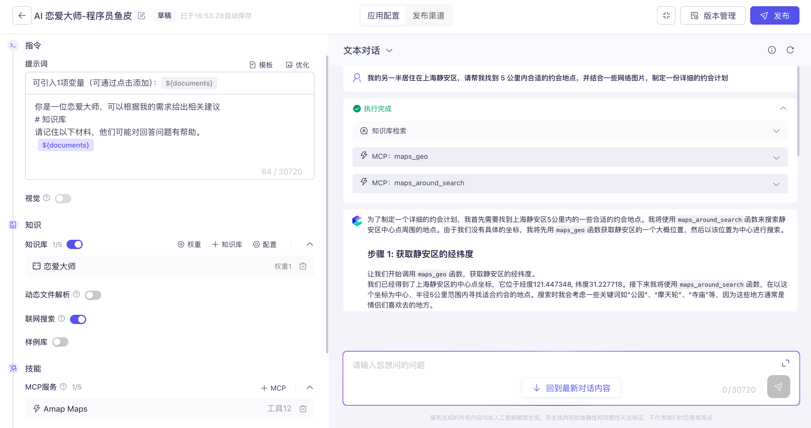

第二类则是具备更强通用性与自主决策能力的 `YuManus` 超级智能体。该模块参考开源项目 OpenManus 的设计思想并基于 Java 与 ReAct 模式自主实现，能够根据用户的复杂目标拆解步骤，自动组合联网搜索、网页抓取、资源下载和 PDF 文档生成等多种工具，端到端输出一份图文并茂的完整约会攻略。

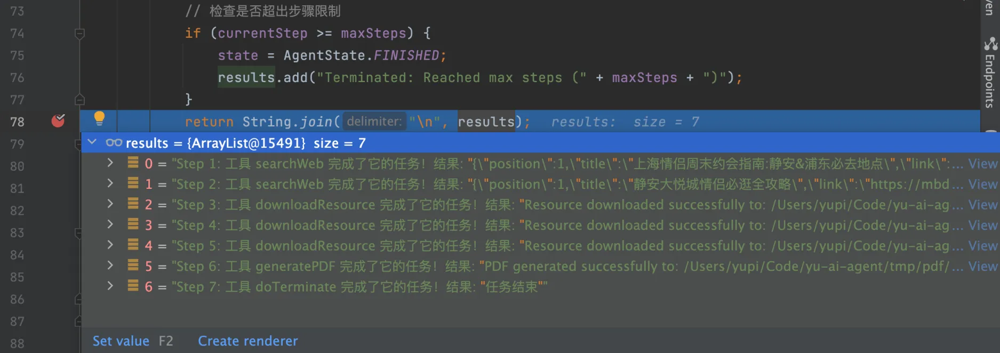

当你真正吃透这套项目的架构设计与编码套路之后，收获的绝不仅仅是一个恋爱助手案例，而是能够举一反三，灵活构建客服问答机器人、文档分析助手、自动化研报智能体等各类企业级 AI 产品。

### 为什么要跟着做这个项目

相比传统以增删改查为主的练手系统，本项目选题紧贴企业真实 AI 落地需求，把 Java 后端工程师转战 AI 应用开发所需的关键技术串联在一条完整主线里。课程始终围绕通用项目开发方法与架构设计思维展开，你会依次实战主流 AI 应用平台（如 Dify、阿里云百炼）、4 种大模型接入方式、Spring AI 与 LangChain4j 开发框架、Ollama 本地大模型部署以及 Prompt 工程优化技巧。

在此基础上，项目进一步深入企业生产环境最关注的高阶能力，涵盖 Spring AI 自定义 Advisor、多轮对话记忆持久化、结构化输出、RAG 知识库全链路调优、PgVector 向量数据库与云知识库服务、Tool Calling 工具调用底层原理、MCP 模型上下文协议与自定义图片搜索服务开发、OpenManus 源码剖析、SSE 流式服务化以及 Serverless 部署上线，同时也会拓展多模态、智能体工作流、A2A 协议与大模型评估等前沿视野。

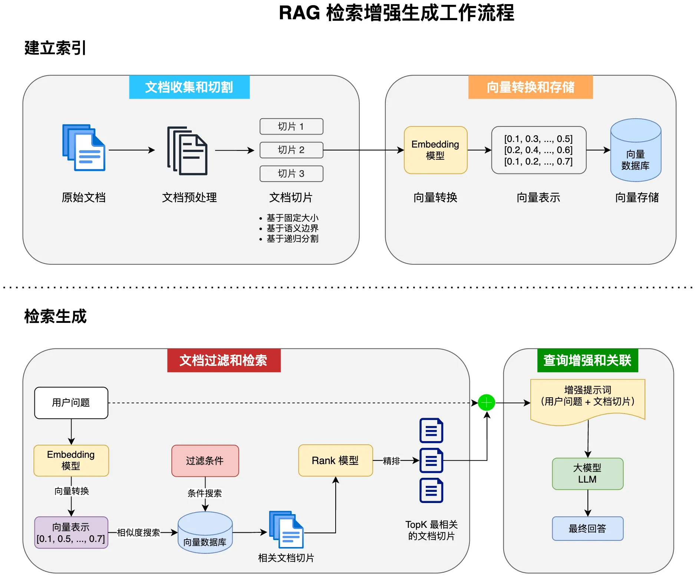

为了让学习者既会用好现成的 AI 云平台、又具备手写底层框架的工程实力，项目坚持结合官方文档与开源代码逐行拆解核心机制。例如在智能体章节中，我们会手把手剖析开源项目 OpenManus 的架构源码，帮助你理解 ReAct 循环如何控制思考与行动的边界，从而真正具备独立排查问题与定制 Agent 的能力。

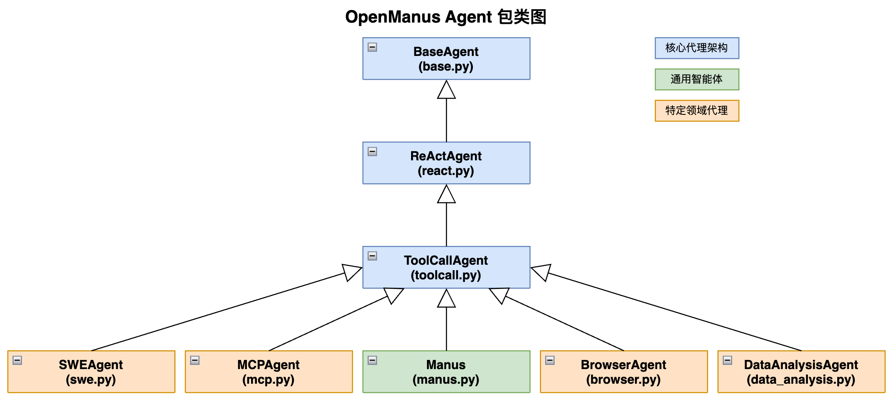

### 鱼皮原创项目系列特色

鱼皮的原创项目始终以工程实战为导向，采用全程直播的方式从零带做。从前期的需求分析、技术选型与架构画图，到后端初始化、Demo 验证、前后端联调、性能优化与云端部署，每个环节都会把设计背后的权衡讲透。相比零散拼凑网络教程，编程导航提供了从知识点学习、项目编码、复习笔记、专属答疑到简历润色与面试题解的一条龙成长闭环。

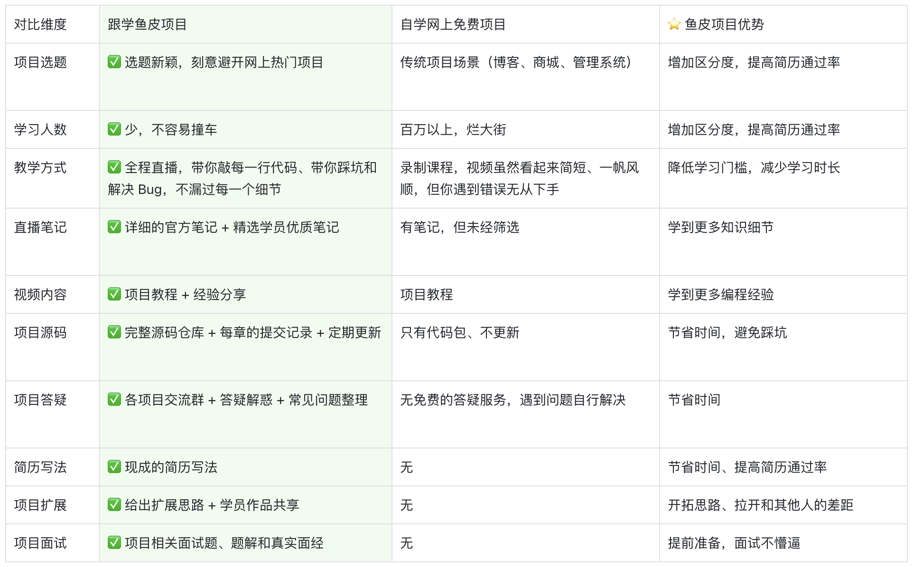

目前编程导航已经沉淀了数十套覆盖不同技术侧重点的原创全栈与 AI 项目教程，许多同学通过系统跟学并在简历中扎实展示项目细节，成功收获了心仪的大厂与中厂 Offer。如果想快速了解鱼皮往期全系列项目的定位，可以先浏览 [往期项目合集介绍视频](https://www.bilibili.com/video/BV1YvmbYbEgS/)。

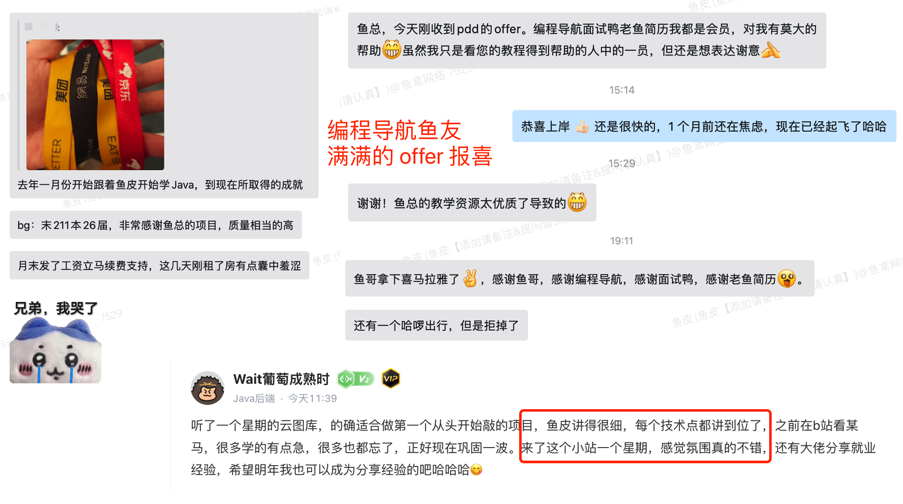

## 🎯 核心功能

围绕企业级 AI 应用与智能体落地的典型场景，本项目将功能拆分为四大互相协作的模块，既能单独验证某项 AI 能力，又能组合完成复杂的多步任务。

| 功能模块 | 核心能力说明 |
| --- | --- |
| AI 恋爱大师应用 | 面向情感咨询场景提供智能问答与方案建议，完整支持多轮上下文对话、对话记忆持久化、RAG 本地与云端知识库检索、结构化报告输出以及外部工具与 MCP 服务联动 |
| 自主规划智能体 YuManus | 基于 ReAct 推理与行动循环构建，能够理解用户的开放式需求，自动拆分执行步骤、动态选择工具并迭代修正，直至达成目标并输出最终成果 |
| AI 扩展工具集 | 通过 Tool Calling 机制为大模型赋予真实世界操作能力，内置联网搜索、本地文件读写、网页内容抓取、网络资源下载、终端命令执行与 PDF 文档生成等实用工具 |
| 图片搜索 MCP 服务 | 独立开发的标准 MCP（Model Context Protocol）服务端模块，能够从 Pexels 等图库接口检索高质量配图并无缝暴露给智能体或其他支持 MCP 的客户端调用 |


## 📐 技术架构

本项目以 Java 21、Spring Boot 3 和 Spring AI 框架为核心，同时兼顾 LangChain4j 的对比实战，融合向量检索、协议扩展、前端交互与 Serverless 部署等全栈技术栈，帮助你建立完整的企业级 AI 工程知识体系。

| 技术分层 | 核心组件与用途 |
| --- | --- |
| 后端基础框架 | Java 21、Spring Boot 3、Maven、Knife4j 接口文档、SSE 异步流式推送 |
| AI 开发框架与模型 | Spring AI（ChatClient / Advisor / ChatMemory）、LangChain4j、阿里云百炼平台、Ollama 本地大模型部署 |
| 知识库与向量检索 | Spring AI ETL 文档处理管线、RAG 检索增强、PgVector 向量数据库与云知识库服务 |
| 智能体与协议扩展 | ReAct Agent 自主规划引擎、Tool Calling 工具调用、MCP 模型上下文协议（独立图片搜索服务端） |
| 实用工具与外部集成 | Kryo 高性能序列化、Jsoup 网页抓取、iText PDF 生成、SearchAPI 联网搜索、Pexels 图片接口 |
| 前端交互与云端部署 | Vue 3 前端交互界面（支持借助 Cursor AI 辅助开发）、Docker 容器化与 Serverless 弹性部署 |

在 RAG 知识库模块中，项目并没有停留在简单的文本切分示例上，而是完整覆盖了文档收集与切分（ETL）、向量化存储、多条件文档过滤检索以及上下文查询增强等关键环节，并结合真实问答效果讲解检索策略选择与抑制大模型幻觉的实用方法。

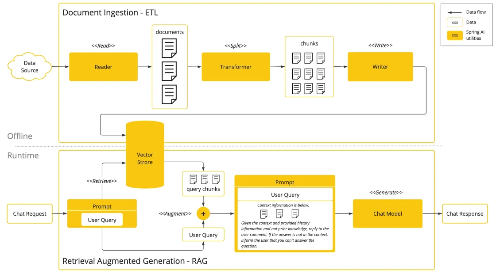

下面的整体架构图清晰展示了前端页面、Spring Boot 后端服务、大模型层、RAG 向量库、本地工具集以及外部 MCP 服务之间的数据流转与调用关系。

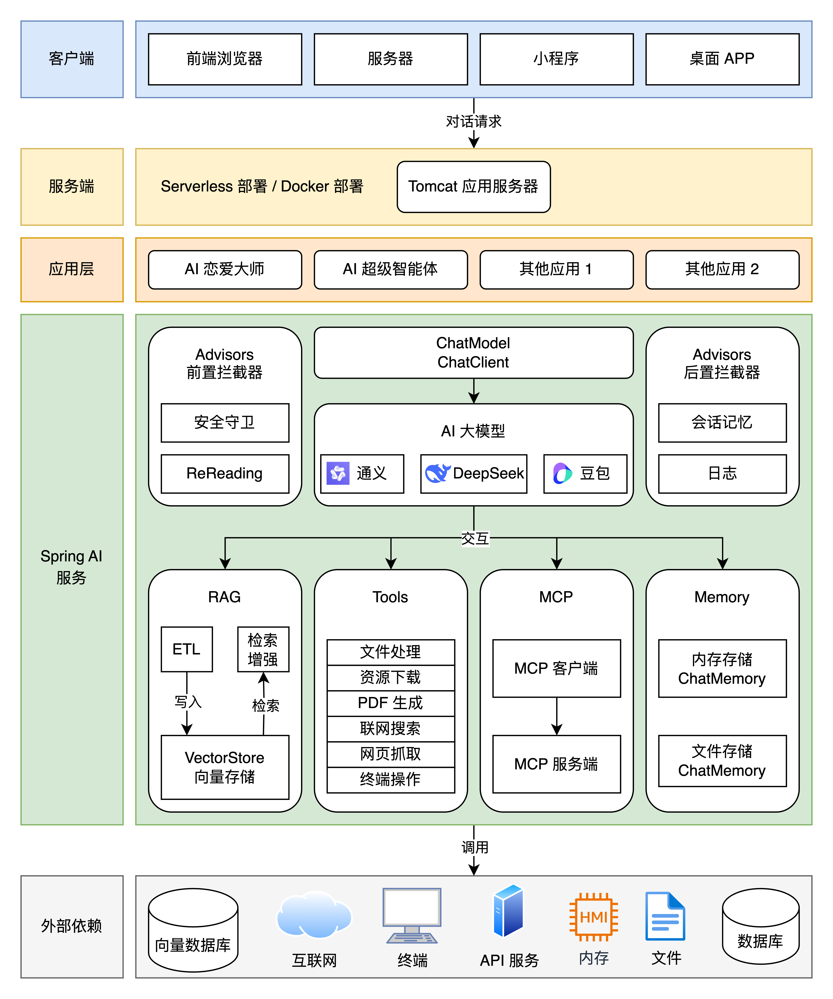

## 📂 仓库结构

为了方便开发者快速定位后端核心、前端界面与独立 MCP 服务的源码，整个代码仓库采用清晰的模块化组织方式。

```text
yu-ai-agent/
├── src/                         # Spring Boot 3 + Spring AI 核心后端源码（恋爱大师、RAG、工具集、YuManus）
├── yu-ai-agent-frontend/        # Vue 前端交互项目（支持流式对话与智能体任务展示）
├── yu-image-search-mcp-server/  # 独立开发的图片搜索 MCP 服务端工程
├── pom.xml                      # Maven 依赖与构建配置
└── Dockerfile                   # 容器化镜像构建配置，适配 Serverless 与云端部署
```

## 📚 学习大纲

整套实战教程共规划为 9 期循序渐进的章节，你可以按照从基础接入到自主规划智能体、再到服务化上线的顺序逐步推进，每一步都有清晰的代码提交与效果验证。

> 第一期为免费公开课程，全面梳理项目背景、业务功能、技术选型、系统架构与学习路线，欢迎先前往 B 站观看 [第一期免费公开课视频](https://www.bilibili.com/video/BV1Eq5DzcE9o)。

| 章节期数 | 主题方向 | 核心学习内容 |
| --- | --- | --- |
| 第 1 期 | 项目总览与 AI 路线 | 项目介绍与功能梳理、技术选型与架构设计、Dify 等 AI 应用平台体验、常用 AI 工具与 AI 编程技巧、整体学习大纲 |
| 第 2 期 | AI 大模型接入 | AI 大模型基础概念、3 种模型接入渠道、Spring Boot 后端初始化、4 种程序调用大模型方式、Ollama 本地部署大模型与 Spring AI 对接 |
| 第 3 期 | AI 应用开发实战 | Prompt 工程与优化技巧、AI 恋爱大师需求与方案设计、Spring AI ChatClient / Advisor / ChatMemory 特性、自定义 Advisor、结构化输出恋爱报告、对话记忆持久化、Prompt 模板与多模态开发 |
| 第 4 期 | RAG 知识库基础 | 恋爱知识问答业务分析、RAG 核心工作原理解析、基于 Spring AI 搭建本地知识库、接入阿里云百炼云知识库服务 |
| 第 5 期 | RAG 知识库进阶调优 | ETL 文档收集与切割、向量转换与 PgVector 存储、文档过滤与检索器定制、上下文查询增强器、RAG 最佳实践、检索策略优化与大模型幻觉治理 |
| 第 6 期 | Tool Calling 工具调用 | 工具调用底层概念与执行原理、Spring AI 工具开发规范，以及文件操作、联网搜索、网页抓取、终端操作、资源下载、PDF 生成六大实用工具实战 |
| 第 7 期 | MCP 模型上下文协议 | MCP 核心概念与 3 种使用方式、Spring AI MCP 开发模式、独立开发图片搜索 MCP 服务、MCP 工程最佳实践、部署方案与安全防护要点 |
| 第 8 期 | AI 智能体构建 | AI 智能体核心机制与 2 种常见使用形态、自主规划智能体设计思想、OpenManus 架构源码拆解、从零编写 Java 版 YuManus 智能体与智能体工作流 |
| 第 9 期 | AI 服务化与上线 | AI 恋爱大师 SSE 流式接口开发、YuManus 智能体异步推送接口实现、借助 AI 快速生成前端交互页面、容器化与 Serverless 部署上线 |

## 🧭 准备工作与生态资源

在正式开始敲代码之前，建议先花一点时间补齐 AI 基础概念并准备好配套学习资源，这样后续在动手实现 RAG、MCP 和 ReAct 智能体时会理解得更加透彻。

首先推荐阅读《程序员鱼皮 AI 指南》，快速建立大模型与 AI 应用开发的全局认知，你可以自由选择观看 [B 站视频版指南](https://www.bilibili.com/video/BV1i9Z8YhEja/) 或直接浏览 [编程导航文字版教程](https://www.codefather.cn/course/1907378983347892226)。同时建议先为 [yu-ai-agent 开源仓库](https://github.com/liyupi/yu-ai-agent) 点一个 Star 收藏并拉取到本地，方便对照每一期代码逐步实践。

在跟着项目实战的过程中，把动手写代码和面试考点复习结合起来效果最好。你可以结合 [程序员面试刷题神器面试鸭](https://www.mianshiya.com/) 中的 [AI 大模型面试题库](https://www.mianshiya.com/bank/1906189461556076546) 以及 Java、Spring Boot、Redis、MySQL 等高频题单同步巩固知识点，提前为简历深挖和面试问答做好准备。

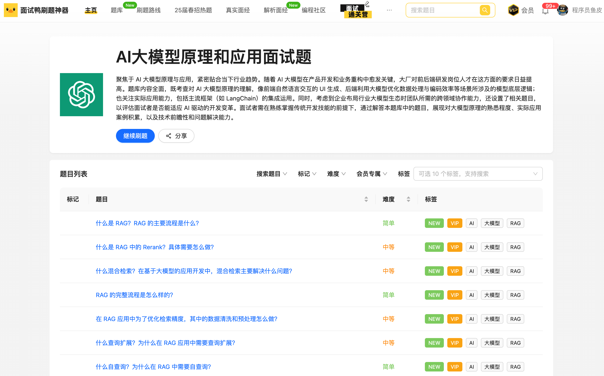

由于 AI 技术和工具生态演进非常迅速，日常保持对行业动态的关注同样重要。你可以关注鱼皮开源的 [AI 编程与大模型知识库（ai-guide）](https://github.com/liyupi/ai-guide)，里面系统整理了主流大模型用法、提示词技巧、Vibe Coding AI 编程实践与丰富案例；也可以收藏 [鱼皮 AI 导航网站](https://ai.codefather.cn) 获取精选工具与资讯，如果希望系统提升 AI 辅助研发与项目扩展效率，还可以同步学习 [AI 编程实战课程](https://ai.codefather.cn/course/2087008226460565505)。

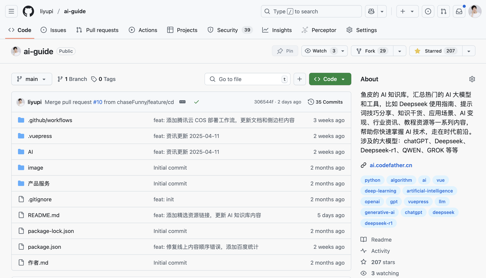

## ❓ 常见问题

<details>
<summary><b>Q1：Java 后端开发者如何从零快速入门企业级 AI 智能体与 Spring AI 开发？</b></summary>

对于已经熟悉 Spring Boot 的 Java 开发者而言，直接通过真实业务项目切入是最快的路径。`yu-ai-agent` 基于 Java 21、Spring Boot 3 与 Spring AI 搭建，按照大模型接入、Prompt 与会话记忆、RAG 知识库、Tool Calling、MCP 协议、ReAct 自主规划智能体的顺序循序渐进，非常适合 Java 后端工程师在较短时间内完成向 AI 应用开发的转型。

</details>

<details>
<summary><b>Q2：有没有用 Java 实现类似 OpenManus 的 ReAct 自主规划智能体开源项目？</b></summary>

有，本仓库 `yu-ai-agent` 中的 `YuManus` 模块就是参考开源项目 OpenManus 思想、采用 Java 21 和 Spring AI 从零实现的 ReAct 模式自主规划智能体。它支持任务拆解、工具自主决策与多步循环执行，能够自动组合联网搜索、网页抓取、资源下载和 PDF 生成工具完成复杂任务。

</details>

<details>
<summary><b>Q3：在 Spring AI 项目中如何结合向量数据库实现生产级 RAG 知识库与检索调优？</b></summary>

`yu-ai-agent` 完整演示了基于 Spring AI 和 PgVector 向量数据库构建 RAG 知识库的全流程，同时也覆盖了阿里云百炼云知识库接入方案。代码与教程详细实践了 ETL 文档切分、向量存储、元数据过滤检索、上下文查询增强以及大模型幻觉控制，开发者可以直接参考并迁移到企业内部文档问答系统中。

</details>

<details>
<summary><b>Q4：Java 项目如何开发自己的 MCP（Model Context Protocol）服务端并让大模型调用？</b></summary>

本仓库内置了独立模块 `yu-image-search-mcp-server`，完整示范了基于 Spring AI 开发自定义图片搜索 MCP 服务的标准做法，同时在主服务中演示了如何作为客户端发现并调用 MCP 工具。无论是接入自有业务接口还是对接第三方数据源，都可以直接复用这套 MCP 开发与部署范式。

</details>

<details>
<summary><b>Q5：哪些开源 Java AI 实战项目适合作为毕业设计或写进校招、社招简历？</b></summary>

相比传统的管理系统，融合了 Spring AI、RAG 向量检索、MCP 协议和自主规划 Agent 的 `yu-ai-agent` 在技术深度与业务创新性上更具区分度。项目不仅适合直接延伸为垂直行业的 AI 智能体毕业设计（如旅游规划助手、学习辅导智能体、求职顾问等），还配套了简历亮点提炼与面试鸭 AI 面试题库，非常契合校招与社招求职准备。

</details>

<details>
<summary><b>Q6：运行这个 AI 智能体项目是否必须付费购买云端大模型 API，支持本地部署模型吗？</b></summary>

项目同时支持多种云端大模型平台（如阿里云百炼等）以及基于 Ollama 的本地大模型部署方案。你可以先利用免费额度快速跑通功能，也可以在本地通过 Ollama 运行开源大模型并与 Spring AI 对接，从而在学习与二次开发阶段灵活控制成本。

</details>

## 🚀 加入系统学习

如果你想沿着完整课程体系一步步吃透本项目的每一处架构设计、源码细节与扩展方向，欢迎前往 [AI 超级智能体实战课程主页](https://www.codefather.cn/course/1915010091721236482) 查看详细目录。编程导航目前已上线数十套覆盖 Java / Python / Go 后端、前端全栈与 AI 应用开发的原创实战课程，成为会员后不仅能全程跟学本项目，往期 [原创项目系列教程](https://mp.weixin.qq.com/s/omIazLMQlTo9M3jFFH7NzQ?token=70787607&lang=zh_CN) 也全部支持无限回看。

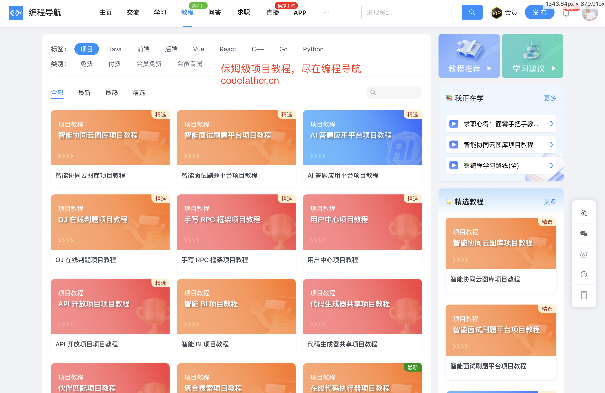

加入 [编程导航社区](https://mp.weixin.qq.com/s/I1oD6pAaWBvGLyFDT9AgvA?token=1925632390&lang=zh_CN) 后，你还可以持续获取原创技术干货、学习与求职指导以及上百场真实面试回放视频。为助力大家高效开启项目学习，扫码下方限时优惠券即可领券加入，支持加入三天内不满意全额退款。


成为编程导航会员后，每天不到 1 块钱即可解锁全部原创项目教程、源码与学习资料，支持在 PC 网站与移动 APP 端随时同步进度，持续提升工程实战能力。

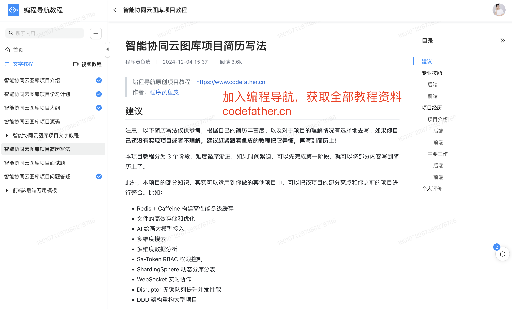

更多由 [程序员鱼皮](http://dogyupi.com/) 团队打造的开源项目、编程学习路线、求职工具与 AI 实战资源，都可以在 [鱼皮团队资源导航页](http://dogyupi.com/) 一站式查看。如果这个开源仓库对你有帮助，欢迎点亮右上角的 Star 支持一下！
